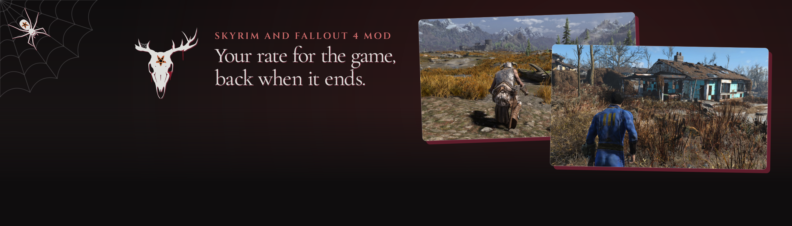
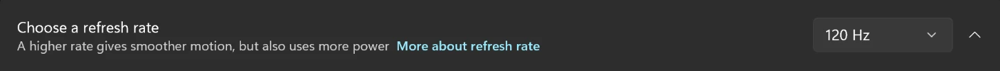
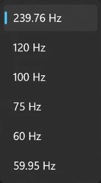

<p align="center">

</p>

Switches your main monitor to the refresh rate you pick when Skyrim or Fallout 4 starts, and puts your old rate back when it ends, so your desktop can stay at a lower rate and you never change it by hand.

<p align="center"><picture>
  <source media="(prefers-color-scheme: dark)" srcset="docs/divider.png">
  
</picture></p>

## How it works

- **On before the game opens.** It runs as the game loads, ahead of the game's window.
- **Back however the game ends.** A normal quit, qqq, a crash, End Task: a small helper waits for the game to go, then puts your old rate back, usually within a second or so.
- **Never saved.** The change isn't written to your Windows settings, so your normal rate stays your normal rate.
- **A rate you set stays.** If you change the rate yourself while the game runs, the mod leaves your choice alone when the game ends.
- **Your main monitor only.** Other monitors stay as they are.

<p align="center"></p>

## Install

1. Download the file for your game from Nexus Mods and install it with your mod manager, or copy its folder into the game's Data folder.
2. Set your rate in `RefreshSwitch.ini` (see below). Until you do, the mod does nothing.
3. Start the game through the script extender as usual.

Requires the Skyrim Script Extender (SKSE) or Fallout 4 Script Extender (F4SE). No Address Library and no Visual C++ redistributable needed. It reads no game memory, so it has no game version to match.

Tested on Skyrim SE 1.5.97 and AE 1.6.640, 1.6.1170 and 1.7.104, and Fallout 4 OG 1.10.163 and AE 1.11.240.

## Choose what it does

`RefreshSwitch.ini` sits beside the DLL, in the script extender's `Plugins` folder. Set the rate you want while the game runs:

```ini
[General]
fRefreshRate=120
```

It has to be a rate your monitor offers; Windows lists them under System, Display, Advanced display. If it isn't, the mod changes nothing and says so in its log. Set it to 0 to turn the mod off without removing it.

<p align="center"></p>

## Good to know

- **It changes your monitor's rate, not your frame rate.** To run above 60 FPS, Skyrim still needs SSE Display Tweaks and Fallout 4 still needs High FPS Physics Fix.
- **It's made for borderless.** In exclusive fullscreen my monitor went to its highest rate as the game's window opened, over this mod's rate, in both games. On Skyrim, SSE Display Tweaks' MaximumRefreshRate sets the rate there instead. The old rate still comes back on closing.
- **Your screen may blink.** It can go dark for a moment when the rate changes, at game start and game end.
- **What I could test.** A 240 Hz monitor on Windows 11, going between 60, 120 and 240. Higher rates take the same steps, but I can't try them here.
- **Two games at once.** If another game with this mod is also open, the one you opened first puts the rate back when it closes, for both.
- **When nothing can put it back.** If you end the helper by hand (rundll32 in Task Manager) and the game goes too, or the PC loses power, the rate stays until you change it in Windows. A restart brings your normal rate back.
- **With HDR Switch** ([Skyrim](https://www.nexusmods.com/skyrimspecialedition/mods/198154), [Fallout 4](https://www.nexusmods.com/fallout4/mods/110988)). It works beside it and they take turns, but neither needs the other.
- **Prefer an app?** AutoActions, a free Windows app, can do this per game too. This mod's point is that there's no separate app to run.
- **Your mod manager may wait a moment.** The helper outlives the game by a second or so, so a manager can show the game as running for that long.
- **A log if you need it.** `RefreshSwitch.log` in the script extender's folder under `Documents\My Games` says what it did on the last launch.

<details><summary>Build it yourself</summary>

You need Visual Studio's C++ build tools, xmake and Python.

```
python tools/build.py
```

It writes the DLL and the zips to `dist`. Set `REFRESH_SWITCH_OFF` in the environment to keep the plugin quiet in test runs; it also stays quiet when the game runs on a hidden desktop.

</details>

## Report a problem

**Found a bug?** Post on the Nexus page's Bugs tab with your game version, what you saw, and this mod's log. I need it for every report, because it shows what the mod actually did:

```
Documents\My Games\Skyrim Special Edition\SKSE\RefreshSwitch.log
Documents\My Games\Fallout4\F4SE\RefreshSwitch.log
```

Send it before you start the game again, because each launch replaces it.

**If the game crashed,** I need two logs: this mod's log, plus the crash log from a crash logger (Crash Logger or Trainwreck on Skyrim, Buffout 4 NG or Addictol on Fallout 4). Without both, I can't tell what crashed or why.

Reports without the logs are closed after 14 days. Post them later and I'll reopen the report.

Logs are long, so link a paste site or bring them to [Discord](https://discord.com/invite/sayngwyn). They can show your Windows username, so use a private report on Nexus if you'd rather.

## More by sayngwyn

[](https://www.nexusmods.com/profile/sayngwyn/mods)

Also on [my website](https://sayngwyn.com/projects).

## Credits

- **SKSE and F4SE teams** for the script extenders it loads through.

---

Made with AI. Claude contributed heavily under my direction: I decided what it does and checked it, and the AI wrote most of the code, its tests and these docs.

## Licence

MIT. See [LICENSE](LICENSE). The sayngwyn skull mark and page art aren't covered by it.
